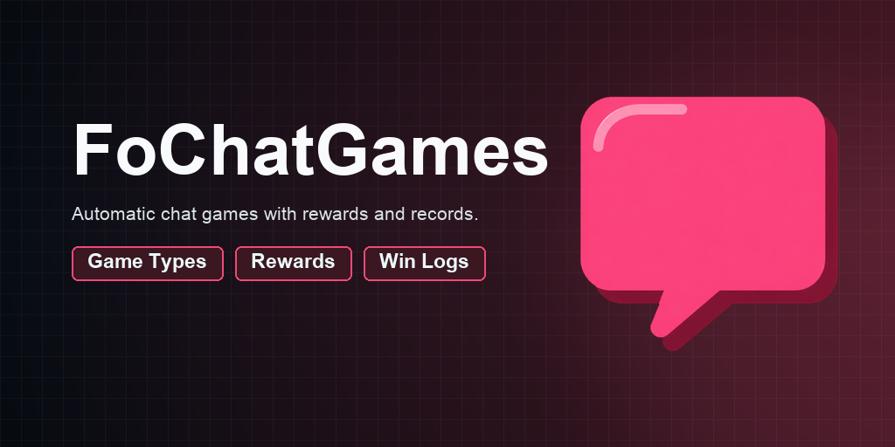
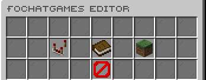
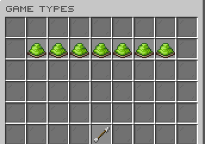
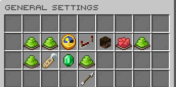
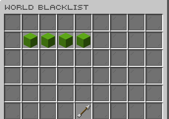

# FoChatGames

[](https://modrinth.com/plugin/fochatgames) [](https://modrinth.com/plugin/fochatgames/versions) [](https://discord.gg/kEF77QCfu7)

Automated chat games with rewards, statistics, controls, and extension events.

*Developed by Carrotio.*

## Features

- Runs automatic chat games for completion, maths, trivia, typing, reversal, unscrambling, and number guessing.
- Supports configurable schedules, rewards, broadcasts, and world exclusions.
- Tracks wins, per-game records, and player preferences in persistent storage.
- Provides administration tools for manual games, logs, statistics, and resets.
- Exposes cancellable Bukkit events and PlaceholderAPI statistics.

## Download and dependencies

Download the latest compatible version from [Modrinth](https://modrinth.com/plugin/fochatgames). Check the [versions page](https://modrinth.com/plugin/fochatgames/versions) for supported Minecraft versions and server platforms.

- **Required:** None
- **Optional integrations:** `PlaceholderAPI`

## Screenshots



*Open the chat games administrator editor.*



*Manage the available game types.*



*Configure general game behavior.*



*Control excluded worlds.*

## Support

For help or issue reports, join the [Carrotio Discord server](https://discord.gg/kEF77QCfu7).

<details>
<summary><strong>Commands and permissions</strong></summary>

### Commands

- `/fochatgames <help|statistics|start|custom|stop|stopall|toggle|status|logs|reset>` — FoChatGames commands Aliases: `/chatgames`, `/chatgame`, `/focg`, `/cg`.
- `/fochatgamesadmin <version|reload|editor>` — FoChatGames commands Aliases: `/chatgamesadmin`.

### Permissions

- `fochatgames.admin` — Access FoChatGames admin command and update notices. Default: `op`.
- `fochatgames.help` — View FoChatGames help. Default: `true`.
- `fochatgames.start` — Start chat games manually. Default: `op`.
- `fochatgames.custom` — Start custom chat games. Default: `op`.
- `fochatgames.stop` — Stop active chat games. Default: `op`.
- `fochatgames.stopall` — Stop all active chat games. Default: `op`.
- `fochatgames.statistics` — View own statistics. Default: `true`.
- `fochatgames.statistics.others` — View other player statistics. Default: `op`.
- `fochatgames.toggle` — Toggle chat game messages and sounds. Default: `true`.
- `fochatgames.status` — View chat game status. Default: `op`.
- `fochatgames.logs` — View win logs. Default: `op`.
- `fochatgames.reset` — Reset player stats. Default: `op`.

</details>

<details>
<summary><strong>PlaceholderAPI</strong></summary>

Requires PlaceholderAPI.

- `%fochatgames_next% / %fochatgames_seconds_until_next%` — Seconds until the next automatic game.
- `%fochatgames_active%` — Whether a game is active.
- `%fochatgames_active_game%` — Key of the active game.
- `%fochatgames_enabled%` — Whether the player receives chat games.
- `%fochatgames_wins% / %fochatgames_wins_raw%` — Player's total wins; aliases include won, chatgames_won, total_wins, and total_won.
- `%fochatgames_record% / %fochatgames_record_raw%` — Player's best record; aliases include best_record and chatgames_record.
- `%fochatgames_wins_<game>% / %fochatgames_wins_<game>_raw%` — Wins for completion, guess_the_number, math, trivia, type, unreverse, or unscramble. Reverse aliases are also accepted.
- `%fochatgames_record_<game>% / %fochatgames_record_<game>_raw%` — Best record for a specific game. Reverse aliases are also accepted.

</details>

<details>
<summary><strong>Configuration</strong></summary>

- `config.yml` — Main behavior and feature settings.
- `messages.yml` — Player-facing messages and interface text.
- `sounds.yml` — Configurable interaction sounds.
- `games/*.yml` — Individual chat-game definitions.

Main config areas: `general`, `native-dialogs`, `world-blacklist`, `rewards`, `broadcasts`.

</details>

<details>
<summary><strong>Developer API</strong></summary>

Compile against the matching jar (`provided` in Maven, `compileOnly` in Gradle); install it locally if needed. Declare `FoChatGames` in your plugin metadata (`softdepend` for an optional integration).

```xml
<dependency>
  <groupId>me.foesio</groupId>
  <artifactId>FoChatGames</artifactId>
  <version>1.7</version>
  <scope>provided</scope>
</dependency>
```

```java
import me.foesio.foChatGames.api.ChatGamesService;
import me.foesio.foChatGames.api.ChatGameEndEvent;

ChatGamesService api = Bukkit.getServicesManager().load(ChatGamesService.class);
if (api != null) api.activeGame();

@EventHandler
public void onChatGameEndEvent(ChatGameEndEvent event) {
    Bukkit.getLogger().info(event.getClass().getSimpleName());
}
```

**API methods** (overloads grouped):

- `ChatGameControlService`: `startRandom`, `start`, `startCustom`, `stop`.
- `ChatGamesService`: `activeGame`, `secondsUntilNext`, `stats`.

**Other API types:** `ChatGameSnapshot`, `ChatGameStats`.

**Events:** `ChatGameEndEvent`, `ChatGameFinishedEvent`, `ChatGameStartEvent`, `ChatGameStartedEvent`, `ChatGameWinEvent`.

[Browse API source](src/main/java/me/foesio/foChatGames/api) for signatures and event details.

</details>
